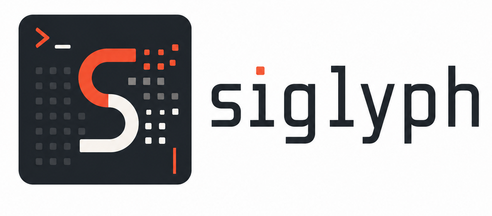

# siglyph

<p align="center">
  
</p>

[](https://github.com/zikolach/siglyph/actions/workflows/ci.yml)

**Build interactive terminal applications in Scala—on the JVM or as native executables.**

siglyph provides editable inputs, fullscreen layouts, scrolling, selection and terminal images without a Node.js runtime. It is inspired by [pi-tui](https://github.com/earendil-works/pi/tree/main/packages/tui); public Scala imports use `scalatui`.

**0.12.0 · Scala 3.9.0 (or a compatible newer compiler) · JDK 21 · macOS/Linux · pre-1.0**

## Quickstart

Install [Scala CLI](https://scala-cli.virtuslab.org/install/) and use a real macOS/Linux terminal. Save this as `hello.scala`, then run `scala-cli run hello.scala --jvm 21`. Type and press Enter; **Esc or Ctrl+C exits** and restores terminal state.

<!-- canonical-example: examples/scala-cli/hello.scala -->
```scala
//> using scala 3.9.0
//> using dep io.github.zikolach::siglyph-core:0.12.0
//> using dep io.github.zikolach::siglyph-terminal-jvm:0.12.0

import scalatui.components.*
import scalatui.core.TUI
import scalatui.terminal.jvm.SttyTerminal

@main def helloSiglyph(): Unit =
  val tui    = TUI(SttyTerminal())
  val status = Text("Type text and press Enter. Esc or Ctrl+C exits.")
  val input  = Input()
  input.onSubmit = value =>
    status.text = s"Last submission: ${if value.trim.isEmpty then "(empty)" else value}"
    input.setValue("")

  tui.addChild(Text("siglyph Scala CLI demo"))
  tui.addChild(Spacer(1))
  tui.addChild(status)
  tui.addChild(Spacer(1))
  tui.addChild(input)
  tui.setFocus(input)
  tui.exitsOnEscape = true
  tui.run()
```
<!-- /canonical-example -->

No checkout, local publishing or GitHub credentials are needed. The example uses Maven Central artifacts. From a checkout, the same source runs with:

```bash
scala-cli run examples/scala-cli/hello.scala --jvm 21
```

For a native executable or Java/Kotlin application, see [Getting started](docs/getting-started.md).

## Demo

[](https://asciinema.org/a/xiB1i6UAo1SgKx4l)

Command filtering, loaders and editable settings built from reusable components. The [recording gallery](docs/asciinema-demos.md) also includes a [prompt composer](docs/asciinema-demos.md#agent-prompt-composer) and Unicode editing. Try the [runnable examples](examples/scala-cli/README.md).

## Install

For an existing Scala JVM application, start with just core and a terminal backend:

```scala
libraryDependencies ++= Seq(
  "io.github.zikolach" %% "siglyph-core" % "0.12.0",
  "io.github.zikolach" %% "siglyph-terminal-jvm" % "0.12.0"
)
```

[Mill, Maven, Gradle and Scala Native setup](docs/getting-started.md). Mill is not required to consume the library with another build tool.

### Modules

| Artifact | Use it for | Targets |
| --- | --- | --- |
| `siglyph-core` | Components, layouts, editing, input and rendering | JVM / Native |
| `siglyph-terminal-jvm` | Interactive JVM terminal; Java/Kotlin facade | JVM |
| `siglyph-terminal-native` | POSIX terminal backend | Native |
| `siglyph-markdown` | Optional Markdown rendering and customization | JVM / Native |
| `siglyph-image` | Optional terminal images and file loading | JVM / Native |
| `siglyph-extras` | Optional expandable text and section helpers | JVM / Native |

Scala Native needs platform-aware coordinates; Java/Kotlin use concrete `_3` artifact names. The setup guide shows both.

## What you can build

- **Forms and editors:** Unicode-aware editing, history, undo, configurable keybindings and async autocomplete. [Input guide](docs/input-and-terminal.md#input-and-editor-integration-hooks)
- **Fullscreen workspaces:** stacks, nested scrolling, follow-end, search, mouse selection and host clipboard copy. [Screen modes](docs/screen-modes.md#height-aware-fullscreen)
- **Popups and menus:** overlays, select/settings lists, loaders and reusable extras. [Components and helpers](docs/input-and-terminal.md#optional-helper-modules)
- **Rich output:** optional Markdown and terminal images, including vertical Kitty cropping. [Image cropping](docs/kitty-vertical-cropping.md)
- **Testable applications:** stream and virtual terminals, typed input/output and optional redacted diagnostics. [Diagnostics](docs/runtime-diagnostics.md)

## Compatibility and limits

- APIs are **pre-1.0**. Check the [changelog](CHANGELOG.md) when upgrading.
- macOS and Linux are the target platforms. Windows and Scala.js/browser support are out of scope.
- Normal-screen mode preserves the shell workflow, but **resize clears scrollback by default**. See [screen modes and the opt-in preservation policy](docs/screen-modes.md#normal-screen).
- Images, advanced keyboard metadata and status reporting depend on terminal support. Fallback behavior is conservative; there is no claim of universal emulator parity.
- Unicode **17.0.0** grapheme segmentation is shared across JVM/Native. Terminal cell width is a separate policy. [Unicode details](docs/unicode.md)
- Siglyph is not a drop-in pi-tui API. See the [version-pinned compatibility comparison](docs/pi-tui-compatibility.md).

## Documentation

Start at the **[documentation index](docs/README.md)** for recipes, reference and maintainer resources.

- [Getting started](docs/getting-started.md) · [Scala CLI examples](examples/scala-cli/README.md) · [Java/Kotlin examples](docs/jvm-language-examples.md)
- [Screen modes](docs/screen-modes.md) · [Typed component output](docs/component-output.md) · [Keybindings](docs/keybinding-defaults.md)
- [Contributing](CONTRIBUTING.md) · [Repository demos](docs/demos.md) · [Security policy](SECURITY.md)

## Attribution and license

Inspired by [pi-tui](https://github.com/earendil-works/pi/tree/main/packages/tui). Upstream attribution is retained in [NOTICE](NOTICE). Licensed under [MIT](LICENSE).
